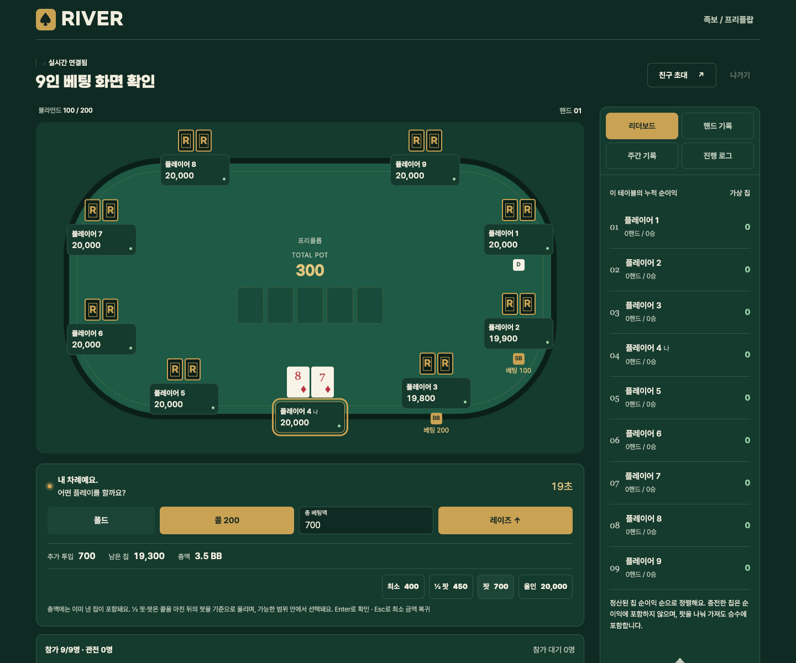

# BGA 참고: 플레이 화면과 베팅 조작 개선

2026-10-28 · RIVER 로컬 적용 · 운영 배포 전

## 근거와 확인 범위

[BGA 텍사스 홀덤 공개 페이지](https://boardgamearena.com/gamepanel?game=texasholdem)의 최근 업데이트 안내를 REA 브라우저로 확인했다. 안내에는 총 베팅액 입력, 추가 투입액·잔여 칩·BB 환산 미리보기, 최소·하프 팟·팟·올인 선택, 키보드 조작, SB/BB 표시가 있다.

실제 관전·리플레이 화면은 게임 iframe이 비어 있어 내부 베팅 동작과 정확한 팟 계산식을 확인하지 못했다. 아래 구현은 공개 안내를 참고해 RIVER의 기존 엔진과 화면에 맞춘 설계이며, BGA의 동작을 그대로 재현했다고 보장하지 않는다. BGA 소스 코드나 이미지 자산은 복제하지 않았다.

- 공개 페이지 근거: `ev_afe3bec38746142811128c1c2fd6853ab151d4de3a487f2b19176ba526ae7375`
- 기존 `benchmark.md`의 과거 관찰 기록과 이번 확인 범위는 구분한다.

## 적용 내용

| 항목 | RIVER에서의 동작 |
| --- | --- |
| 총액 미리보기 | 이미 낸 칩을 뺀 추가 투입액, 행동 후 남는 칩, 총액의 BB 환산을 표시한다. |
| 빠른 금액 선택 | 최소·½ 팟·팟·올인과 실제 선택 금액을 함께 표시한다. 클릭은 금액만 선택하며 레이즈 확인 후 전송한다. |
| 입력과 키보드 | 허용 범위 밖 입력은 안내하고 전송을 막는다. Enter는 레이즈 확인, Escape는 최소 금액 복귀다. 기존 올인 확인창을 유지한다. |
| 중복 입력 방지 | 행동 응답을 기다리는 동안 행동 버튼·금액 입력·프리셋을 모두 비활성화한다. |
| 플레이어 좌석 | 핸드 진행 중 D·SB·BB와 이번 라운드 베팅액을 표시한다. 2인 게임에서는 D와 SB를 함께 표시한다. |
| 작은 화면 | 빠른 선택 버튼을 2열로 배치하고 미리보기를 줄바꿈한다. |

팟 프리셋은 RIVER에서 다음 기준을 선택했다. 이는 BGA 내부 수식을 관찰한 결과가 아니다.

```text
콜 후 팟 = 현재 팟 + 콜에 필요한 칩
선택 총액 = 현재 최고 베팅액 + 반올림(콜 후 팟 × 비율)
비율 = ½ 팟은 0.5, 팟은 1
선택 총액은 엔진이 허용한 최소·최대 범위로 제한
추가 투입액 = 선택 총액 − 내가 이번 라운드에 이미 낸 칩
```

예를 들어 100/200 블라인드의 2인 게임에서 SB가 이미 100칩을 냈고 팟이 300칩이면, 팟 버튼은 총액 600칩을 선택한다. 추가로 내는 칩은 500칩이다. ½ 팟 값이 최소 레이즈보다 작으면 최소값을 선택하므로 두 버튼의 금액이 같을 수 있다.

이번 변경 파일은 `public/app.js`, `public/style.css`, 새 파일 `public/betting.js`, `test/betting.test.js`와 이 문서·화면 캡처다. 기존 작업 중이던 엔진·서버 변경은 보존했으며, 이번 작업에서 서버 게임 규칙은 변경하지 않았다.

## 검증 결과

- `npm test`: 64개 통과. 이미 낸 블라인드 공제, 팟 프리셋, 최소·최대 한도, 짧은 올인, 잘못된 금액 검증을 포함한다.
- `npm run check`, `npm run deploy:check`, `git diff --check`: 통과. 배포 검사는 빌드 확인이며 실제 운영 배포는 수행하지 않았다.
- 로컬 Worker의 `node test/integration.mjs`: 인증, Origin 검사, 2인 WebSocket 동기화, 개인패 보호, 오래된 행동 거부, 한 핸드 진행, 칩 보존, 랭킹, 재접속, 방장 이전 검증 통과.
- 실제 엔진을 사용하는 임시 UI 환경에서 REA 브라우저로 2인·9인, 1440px·390px·320px 화면을 확인했다. 페이지 오류는 수집되지 않았다.
- 잘못된 금액으로 Enter를 눌러도 전송되지 않고, Escape로 최소값으로 돌아가며, 팟 총액 600을 Enter로 제출했을 때 서버가 수락하는 것을 확인했다.
- 응답 지연 중 입력과 모든 베팅 버튼이 비활성화되는 것을 확인했다. 올인 확인창을 취소한 경우 행동이 전송되지 않은 상태도 확인했다.

| 브라우저 검증 | REA 근거 ID |
| --- | --- |
| 9인 데스크톱 | `ev_4c4172dd95dd40cefd49b6aec4f9c5aac13576c9ee83dee6ef7240f58cd37b44` |
| 2인 모바일 | `ev_6529224ba1f6473611a6acd0455d045289b65203d61571e5326ed47dfada3337` |
| 9인 320px | `ev_9769aa40ae2d5b2436804251d8ec837e116810e480e11b98a16ef286ad18648c` |
| 금액·키보드 | `ev_0fd693d9140f4d1230199c1ea211031d7c2222d6fd167d6d9feeb237ccd31318` |
| 응답 대기 | `ev_5550b302a61140d38200257ed3bba0f8457126a90a879056607fa8e64b1c9f16` |

## 화면

샘플 플레이어를 사용한 로컬 검증 화면이다.



[2인 모바일 390px](screenshots/bga-betting-mobile-2026-10-28.png) · [9인 모바일 320px](screenshots/bga-betting-mobile-320-2026-10-28.png)
