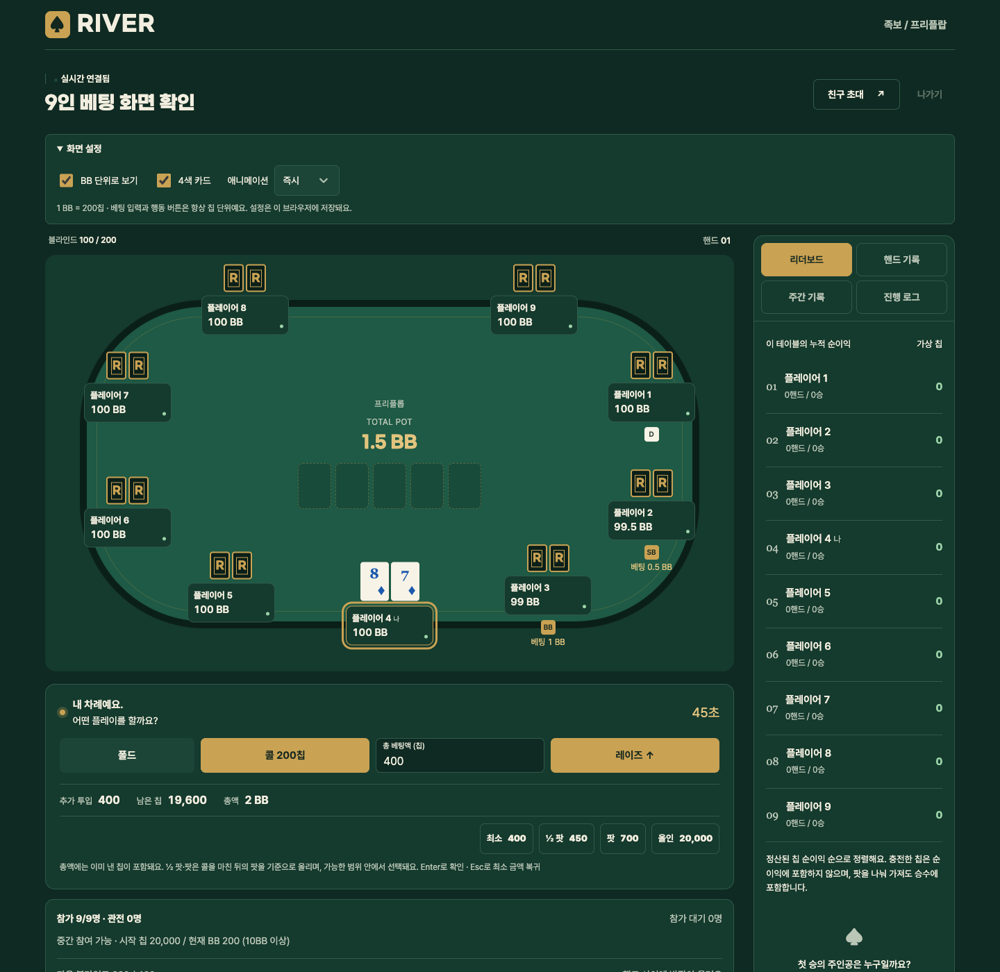

# BGA 참고: 표시 설정 추가

2026-10-29 · 플레이 화면과 베팅 조작 개선 후속 작업

## 적용 내용

테이블의 **화면 설정**에서 다음을 바꿀 수 있다. 브라우저의 로컬 저장소에 보관하며 다른 플레이어의 설정이나 게임 규칙에는 영향을 주지 않는다.

- **BB 단위로 보기:** 보유 칩, 이번 라운드 베팅, 전체 팟을 현재 빅 블라인드로 나눠 소수 둘째 자리까지 표시한다. 원래 칩 수는 값의 툴팁 또는 접근성 설명에 남긴다. 베팅 입력·콜 버튼·프리셋·전송값은 계속 칩 단위이며 입력 레이블에도 단위를 명시한다.
- **4색 카드:** 스페이드는 기존 검정, 하트는 기존 빨강, 클럽은 초록, 다이아몬드는 파랑으로 표시한다. 숫자는 굵게 표시하며 무늬 기호와 접근성 설명을 유지한다. 상대의 비공개 패는 계속 뒷면이다.
- **애니메이션:** 보통·빠르게·즉시 중 선택한다. 빠르게는 카드·행동·승리 연출과 상태 전환 대기 시간을 절반으로 줄인다. 즉시는 연출과 상태 대기를 없앤다. 운영체제의 동작 줄이기 설정이 켜져 있으면 항상 이를 우선한다.

설정 변경 시 같은 차례에 입력하던 베팅 총액과 설정 패널 열림 상태, 키보드 포커스를 유지한다. 새로고침하면 표시 설정을 복원하되 베팅 입력은 새 상태의 최소 금액부터 시작한다.

## 근거와 범위

[BGA 텍사스 홀덤 공개 업데이트](https://boardgamearena.com/gamepanel?game=texasholdem)에서 BB 표시, 선택형 4색 카드, Normal/Fast/Instant 애니메이션을 확인했다. 공개 안내의 REA 근거는 `ev_afe3bec38746142811128c1c2fd6853ab151d4de3a487f2b19176ba526ae7375`다. BGA 내부 게임 프레임은 열리지 않아 실제 구현이나 동작의 동일성은 확인하지 못했다. 소스와 이미지를 복제하지 않고 RIVER에 맞춰 구현했다.

커밋에는 이번 표시 설정과 [앞선 베팅 개선](bga-betting-2026-10-28.md)만 포함한다. 기존 작업 디렉터리에 있던 랭킹 기간·관전·참가 대기·칩 규칙·서버 변경은 수정 없이 남긴다. 따라서 아래 화면은 기존 변경이 함께 있는 로컬 샘플 환경이며, 커밋 자체가 시작 칩이나 블라인드를 바꾸는 것은 아니다. 실제 운영 배포는 수행하지 않는다.

## 검증

| 범위 | 결과 |
| --- | --- |
| 현재 작업 디렉터리 | 테스트 64개, 구문 검사, Worker 배포 모의 검사 통과 |
| HEAD + 이번 변경만 담은 커밋 후보 | 테스트 32개, 구문 검사, Worker 배포 모의 검사 통과 |
| 커밋 후보의 별도 로컬 Worker | 인증, Origin 검사, WebSocket 동기화, 비공개 패, 오래된 행동 거부, 한 핸드, 칩 보존, 랭킹, 재접속, 방장 이전 통합 검증 통과 |
| 실제 브라우저 | 1440px 9인 / 320px 2인 화면 확인, 수집된 페이지 오류 없음 |
| 설정 변경과 복원 | 입력값 750 유지, 빠르게·즉시 선택, 새로고침 뒤 BB·4색·속도 설정 복원 확인 |
| 베팅 값 | BB 표시를 켠 상태에서 Enter로 750 제출 → 서버가 `amount: 750` 수락, 남은 칩 19,250 확인 |

베팅 테스트는 20,000칩·100/200 블라인드를 fixture에 직접 설정해 다른 미커밋 엔진 변경에 의존하지 않도록 했다. 실제 모바일 기기 테스트와 운영 배포 검증은 포함하지 않는다.

REA 브라우저 근거:

- 설정 변경·새로고침 복원: `ev_939ca9fb356467be5b118c642d316ed41ccc1434dbf456b4f73ca5b87582a056`
- 320px 및 동작 줄이기 환경: `ev_ef6f2519dc75518e11a48e91c85459a5f198055f29934f7966fc5148ba61ad90`
- 최종 모바일 화면: `ev_ba8743815284e6d8bd3a2d9c47254e13a7697a0d9acc3e730a0ef9b625f13fa9`
- BB 표시 상태의 칩 전송: `ev_369b517340c0a07ff3580bbc0763dda8fb7e0ac9039c543280b958f10ed14dcb`

[320px 모바일 화면](screenshots/bga-display-mobile-2026-10-29.png)
