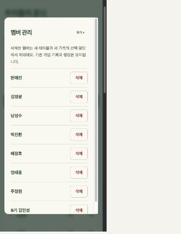

# 멤버 삭제 기능

2026-10-23 운영 배포: `24bba750-28e2-4648-aa7c-4ad76bc3d1d7`

홈의 `멤버 관리`에서 이름 옆 `삭제`를 선택하고, 앱 안의 확인 화면에서 `삭제 확인`을 누릅니다. 기본 멤버와 등록 멤버 모두 삭제할 수 있습니다. 취소하거나 닫으면 삭제하지 않습니다.

## 데이터 영향

- 삭제는 선택 명단에서 제외하는 방식입니다. 개인정보와 과거 기록을 완전히 지우는 기능은 아닙니다.
- `deleted-member-keys`에 제외할 회원 키만 저장합니다. 기존 회원 원문, 수동 게임 기록, 테이블 장부와 게임 데이터는 바꾸지 않습니다.
- 삭제 멤버는 새 테이블과 새 수동 기록에서 선택할 수 없습니다. 과거 기록이 있으면 랭킹과 게임별 기록에 `삭제된 멤버` 표시로 남습니다. 참여했던 기록은 계속 수정할 수 있습니다.
- 이름만 있던 구형 기록도 원래 전체 명단 순서로 연결하므로, 같은 이름의 다른 기수 회원에게 기록이 넘어가지 않습니다.
- 등록회원이 같은 기수와 이름으로 재가입하면 기존 회원 키와 기록을 이어갑니다. 기존 테이블의 참가자를 강제로 퇴장시키지는 않습니다.
- 기존 Worker, Durable Object 이름과 바인딩, 마이그레이션 및 게임 엔진을 유지했습니다. 삭제 API에도 기존 세션과 동일 출처 검사를 적용했습니다.

## 검증

- 전체 테스트 28개 통과. 기본/등록 멤버 삭제, 같은 요청 반복, 기존 저장값 보존, 동명이인 연결, 삭제 회원의 기존 기록 수정과 신규 선택 거부, 재가입 및 재시작, API 세션과 Origin 검사 포함.
- 격리된 로컬 브라우저에서 삭제 취소, 닫기 후 재열기, 실제 삭제, 기록 원문 보존, 기존 기록 수정과 새로고침, 전체 명단 삭제 후 신규 등록, 같은 기수/이름 재가입을 확인했습니다.
- 320px와 390px에서 삭제 확인 화면의 가로 넘침이 없고 확인/취소 버튼 높이는 48px입니다. 삭제 확인은 브라우저 기본 팝업 대신 앱 화면 안에서 처리합니다.
- 배포 후 실제 운영 회원 8명, 게임 기록 1개와 랭킹을 배포 전 원문과 대조해 일치를 확인했습니다. 운영 회원을 시험 삼아 삭제하거나 검증 회원을 추가하지 않았습니다.
- 배포된 앱 파일 3개의 해시와 기존 Durable Object 연결을 확인했습니다. 운영 멤버 관리에 8명이 표시되고 브라우저 오류가 없었습니다.
- 검증 서버를 종료하고 로컬 저장소, 테스트 기록 파일, 검증 브라우저의 선택값과 세션 쿠키를 정리했습니다. 테스트 코드는 유지했습니다.

